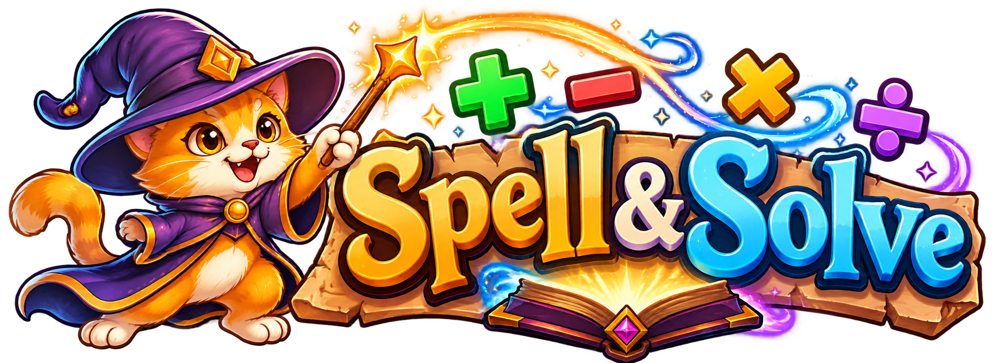

# ✨ Spell & Solve

<p align="center">
  
</p>

> Pequenas contas. Grandes feitiços.

Um jogo educativo de fantasia: ajude um gato mago a defender seu bosque resolvendo contas antes que as criaturas se aproximem. Desenvolvido para a avaliação de Integração e Entrega Contínua do segundo semestre de ADS.

**JavaScript ES Modules · HTML5 Canvas · Vite · Vitest · Playwright · GitHub Actions**

[Como jogar](#-como-jogar) · [Executar](#-executar-no-computador) · [Publicação online](#-jogar-online) · [Documentação](#-documentação) · [Licença](#-autoria-e-licença)

## 🎮 Como jogar

1. Escolha a dificuldade e clique em **Jogar**.
2. Digite o resultado de uma conta e pressione **Enter** ou **Lançar**.
3. Defenda o gato: cada criatura que o alcança remove uma das **três vidas**.

| Dificuldade | Operações | Limites das contas |
| --- | --- | --- |
| Fácil | Soma e subtração | Números até 20 |
| Médio | Soma, subtração e multiplicação | Soma/subtração até 50; multiplicação até 20 × 9 |
| Difícil | Todas as operações | Soma/subtração até 99; multiplicação de 10–99 × 2–9; divisão exata com dividendo até 99 |

Cada acerto vale **10 pontos × onda**. A cada cinco acertos, as criaturas ficam mais rápidas e frequentes. Se duas contas têm a mesma resposta, o feitiço atinge a criatura mais próxima. Respostas erradas não retiram vidas.

O recorde fica salvo no navegador. Música ambiente, efeitos e volume têm controles próprios. A partida e o áudio pausam quando a aba fica oculta. Sem cadastro, banco de dados ou ranking online.

## ✦ Bosque encantado — refinamento local

A apresentação agora acompanha uma clareira de luar com moldura, grimórios de dificuldade e barra de conjuração. Três variantes de criaturas mantêm sua identidade ao longo da partida. Feitiços têm lançamento, impacto, dissolução e valor ganho; o gato reage ao conjurar, sofrer dano e encerrar a partida.

**Sequências:** marcos em 3, 5 e 10 acertos, sem multiplicar pontos. Entrada malformada preserva a sequência; inteiro incorreto ou perda de vida a interrompem. A melhor sequência aparece no resumo final. A pontuação continua em 10 × onda, com avanço a cada cinco acertos totais.

**Pausa:** botão Pausar/Retomar ou **Esc**; a tecla P também funciona fora do campo de resposta. A pausa congela inimigos, efeitos e áudio. Ao voltar de uma aba oculta, uma pausa manual continua ativa. O campo preserva e seleciona valores errados; acertos limpam a entrada.

As contas usam etiquetas DOM de pelo menos 16 px, com identificadores e linhas até as criaturas. A lista textual acompanha a ordem de aproximação e indica urgência. Movimento reduzido também vale para o Canvas. Não houve teste em celular físico nem validação completa com tecnologia assistiva.

Este refinamento está na branch local `codex/enchanted-forest`; o endereço público abaixo pertence à última versão publicada, não a estas alterações. [Evidências e reversão](docs/refinamento.md).

## 🌐 Jogar online

O jogo pode ser jogado online pelo **GitHub Pages**, diretamente no navegador, sem instalação:

**[🎮 Jogar Spell & Solve](https://h6pw.github.io/SpellnSolve/)**

## 💻 Executar no computador

### Desenvolver a partir do código

Requisitos: **Node.js 24.13.1** e **npm 11**.

```sh
npm ci
npm run dev
```

Abra o endereço informado pelo Vite. Para verificar o projeto:

```sh
npm run lint
npm run content:validate
npm run test:ci
npm run build
npm run test:e2e
```

Antes do primeiro E2E, instale o navegador de teste com `npx playwright install chromium`. Os requisitos de PDF e os demais comandos estão no [guia de desenvolvimento](docs/desenvolvimento.md).

### Jogar a partir do ZIP

`artifacts/build.zip` é o **jogo compilado**, não o código-fonte para desenvolvimento. Ele é gerado pelo build e pelo empacotamento e também pode ser obtido nos artefatos de uma execução bem-sucedida da CI.

1. Extraia **todos** os arquivos do ZIP para uma pasta.
2. Com Node.js instalado, abra um terminal nessa pasta e execute `node serve.mjs`.
3. Acesse **http://127.0.0.1:4173** e mantenha o servidor aberto enquanto joga.

Não precisa de internet nem de `npm install`. Abrir `index.html` com dois cliques não é suportado: os módulos ES precisam de HTTP. Para jogar sem terminal ou instalação, use a publicação no GitHub Pages.

O `build.zip.sha256` permite verificar a integridade do pacote. Os arquivos de `artifacts/` são gerados e não entram no Git.

## 🧪 Qualidade e entrega

A suíte preserva os dez testes unitários originais e cobre regras, integração, interface e áudio. A última validação local registrada contém **66 testes de unidade/integração e 13 E2E**; consulte as [evidências](docs/evidencias.md) para contexto e limitações. Isso não substitui o resultado de uma execução remota.

A CI está preparada para lint, JUnit, cobertura, build, PDF do GDD, auditoria de dependências, Gitleaks, SBOM e ZIP com SHA-256. Deploy, releases, monitoramento e submissão dependem de configuração e evidências reais.

## 📁 Estrutura

```text
src/
  core/           Matemática, desafios e estado
  content/        Configuração das dificuldades
  game/           Inimigos, Canvas, entradas, armazenamento e áudio
  main.js         Interface e ciclo do jogo
  style.css       Estilos responsivos
tests/
  unit/           Testes unitários
  integration/    Integração e scripts
  e2e/            Jornadas de navegador e smoke tests
docs/             GDD, evidências e documentação técnica
scripts/          Build, pacote, publicação e observabilidade
.github/workflows/ CI/CD e tarefas automatizadas
```

## 📚 Documentação

| Documento | Conteúdo |
| --- | --- |
| [GDD](docs/gdd.md) | Conceito, mecânicas e critérios de aceitação |
| [Guia de desenvolvimento](docs/desenvolvimento.md) | Comandos, CI/CD, rollback, DORA e submissão |
| [Evidências](docs/evidencias.md) | Verificações executadas e pendências |
| [Relatório técnico](docs/relatorio.md) | Base para o relatório da avaliação |
| [Pitch](docs/pitch.md) | Roteiro da apresentação |
| [Squad](SQUAD.md) | Integrantes e responsabilidades a preencher |
| [Uso de IA](AI-USAGE.md) | Registro da assistência e revisão humana |
| [Recursos e licenças](THIRD_PARTY.md) | Origem e direitos dos recursos |

## 📝 Autoria e licença

Código e recursos próprios sob a [licença MIT](LICENSE), com identificação `h6pw`. A logo foi fornecida pelo responsável e gerada no ChatGPT; o modelo não foi informado. As dependências e os materiais de terceiros mantêm suas próprias licenças, documentadas em [THIRD_PARTY.md](THIRD_PARTY.md).

Antes da entrega final, faltam dados reais do squad, revisão humana, vídeo, relatório final e evidências dos fluxos remotos. Essas pendências estão detalhadas na documentação.
